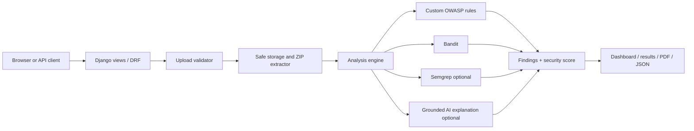

# CODEGUARDIAN

AI-powered secure code review platform built with Django, Django REST Framework, and deterministic static analysis.

CODEGUARDIAN accepts a single source file or a ZIP project, runs layered security analysis without executing uploaded code, maps findings to OWASP categories, calculates a severity-weighted security score, and produces remediation guidance plus PDF/JSON reports.

## Highlights

- Django web workspace with custom dark, code-editor-inspired UI.
- Django REST Framework API with token authentication.
- Static analysis for Python, JavaScript/JSX/TS/TSX, and Java.
- Custom OWASP rule pack plus Bandit and optional Semgrep integration.
- Optional Gemini explanations that only describe findings already produced by analysers.
- Strict upload validation: size limits, extension allowlist, ZIP containment, symlink rejection, encrypted-entry rejection, and no code execution.
- Owner-scoped scans, findings, files, reports, audit logging, and admin moderation.
- Severity-weighted score from 0 to 100.
- PDF reports with ReportLab and JSON exports.

## Architecture



## Project layout

```text
CodeGuardian/
├── analysis/                 Static analysers and rule definitions
│   ├── rules.py              Custom OWASP rule pack
│   ├── bandit.py             Python AST analyser adapter
│   ├── semgrep.py            Optional structural analyser adapter
│   ├── semgrep_rules.yml     Local Semgrep rules
│   ├── ai.py                 Deterministic + optional Gemini explanations
│   └── engine.py             Analysis orchestration and scoring
├── apps/
│   ├── accounts/             Custom user, registration, profile
│   ├── core/                 Dashboard, audit, permissions, API root
│   ├── reports/              PDF/JSON generation and downloads
│   └── scan/                 Uploads, scan models, finding views, scan API
├── config/                   Django settings and URL configuration
├── docs/                     Architecture, API, and security notes
├── samples/vulnerable_project/  Intentional sample issues for demos
├── static/                   Custom CSS and JavaScript
├── templates/                Django templates
├── tests/                    Automated test suite
├── manage.py
└── requirements.txt
```

## Quick start

Requires Python 3.10 or newer.

```powershell
cd CodeGuardian
python -m venv .venv
.\.venv\Scripts\Activate.ps1
pip install -r requirements.txt
python manage.py migrate
python manage.py createsuperuser
python manage.py runserver
```

Open `http://127.0.0.1:8000/`, sign in, then choose **New Scan** and upload `samples/vulnerable_project/app.py` or a ZIP of the sample folder.

## Configuration

Copy `.env.example` to `.env` and adjust as needed.

| Variable | Default | Purpose |
|---|---:|---|
| `DJANGO_SECRET_KEY` | local development key | Django signing key |
| `DJANGO_DEBUG` | `true` | Debug mode; set false in production |
| `DJANGO_ALLOWED_HOSTS` | `localhost,127.0.0.1,[::1]` | Comma-separated hosts |
| `DB_ENGINE` | empty | Set to a Django DB engine to use PostgreSQL |
| `CG_MAX_FILE_SIZE_MB` | `10` | Single source file limit |
| `CG_MAX_ZIP_SIZE_MB` | `25` | Uploaded ZIP limit |
| `CG_MAX_UNZIPPED_MB` | `100` | Extracted ZIP limit |
| `CG_MAX_ZIP_FILES` | `200` | Source files per ZIP |
| `CG_BANDIT_ENABLED` | `true` | Run Bandit for Python |
| `CG_SEMGREP_ENABLED` | `true` | Try Semgrep when installed |
| `CG_ENABLE_AI` | `false` | Enable Gemini explanations |
| `GEMINI_API_KEY` | empty | Gemini API key |
| `GEMINI_MODEL` | `gemini-1.5-flash` | Gemini model name |

Semgrep is optional. To enable it, install `requirements-security.txt`.

```powershell
pip install -r requirements-security.txt
```

## REST API

Base path: `/api/v1/`

```text
POST /api/v1/auth/token/          Obtain DRF token
GET  /api/v1/scans/               List scans
POST /api/v1/scans/               Upload file/ZIP and run scan
GET  /api/v1/scans/{id}/          Scan detail with findings
GET  /api/v1/findings/            List findings; filter by ?scan= or ?severity=
GET  /api/v1/files/               List analysed files
GET  /api/v1/reports/             List generated reports
GET  /api/v1/analytics/summary/   Dashboard metrics
GET  /api/v1/recommendations/     OWASP-aligned secure guidelines
```

Example upload:

```powershell
curl -H "Authorization: Token <token>" -F "name=Demo scan" -F "source_file=@samples/vulnerable_project/app.py" http://127.0.0.1:8000/api/v1/scans/
```

## Scanner model

- Uploaded files are written under `media/uploads/<scan-id>/` after validation.
- ZIP entries are canonicalised and must stay inside the scan directory.
- Symlinks, absolute paths, Windows drive paths, encrypted entries, and unsupported extensions are rejected.
- Uploaded code is never imported, evaluated, compiled, or executed.
- Findings are deduplicated by file, rule, and line.
- Security score starts at 100 and subtracts severity weights: critical 20, high 10, medium 5, low 2.
- AI is optional and receives only finding metadata; it cannot add or remove findings.

## Tests

```powershell
python manage.py check
python manage.py makemigrations --check --dry-run
python manage.py test
```

Run a focused suite:

```powershell
python manage.py test tests.test_analysis tests.test_scans tests.test_api tests.test_reports
```

## Production notes

- Set `DJANGO_DEBUG=false`, a strong `DJANGO_SECRET_KEY`, real `DJANGO_ALLOWED_HOSTS`, and secure cookie/HSTS settings.
- Use PostgreSQL through `DB_ENGINE=django.db.backends.postgresql` and related `DB_*` variables.
- Run `python manage.py collectstatic` and serve static files through WhiteNoise.
- Run behind Gunicorn, for example: `gunicorn config.wsgi:application --bind 0.0.0.0:8000`.
- Keep `media/` outside the web root in deployment and rotate stored uploads according to your retention policy.

## License

MIT License. Copyright (c) 2026 N J Bala Manikantan. See `LICENSE`.
