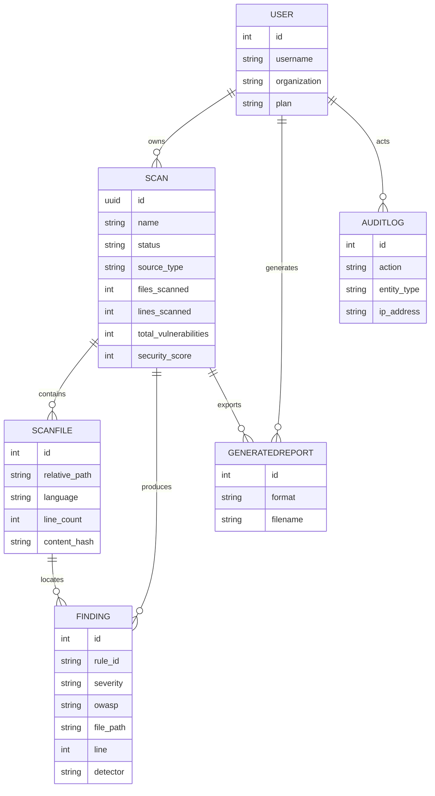

# Architecture

## Request flow

1. A browser or API client submits a file through Django views or DRF.
2. `apps.scan.services.validate_upload` checks extension, size, and ZIP signature.
3. `process_upload` saves the scan, stores files under `media/uploads/<scan-id>/`, and records `ScanFile` metadata.
4. `run_scan` calls `analysis.engine.analyze_paths`.
5. The engine runs custom rules, Bandit, and optional Semgrep, then deduplicates and sorts results.
6. Optional AI enrichment explains only existing findings.
7. `Finding` rows are created; scan totals and security score are updated.
8. Results render in the dashboard/result templates or serialize through DRF.
9. Reports are written to `media/reports/` and registered as `GeneratedReport` rows.

## Data model

## Analyser layers

| Layer | Scope | Enabled by |
|---|---|---|
| Custom rules | Python, JS/JSX/TS/TSX, Java | Always |
| Bandit | Python | `CG_BANDIT_ENABLED` |
| Semgrep | All supported languages | `CG_SEMGREP_ENABLED` and installed package |
| Gemini | Explanations only | `CG_ENABLE_AI` and API key |

## Safety boundaries

- No dynamic import, `eval`, `exec`, shell execution, or subprocess invocation of uploaded files.
- ZIP extraction is bounded by member count, per-file size, uncompressed size, and containment checks.
- Symlinks and encrypted ZIP entries are rejected before writing.
- Object-level permissions scope scans and reports to their owner unless the user is a superuser.
- Audit middleware records mutating requests and denial events.
