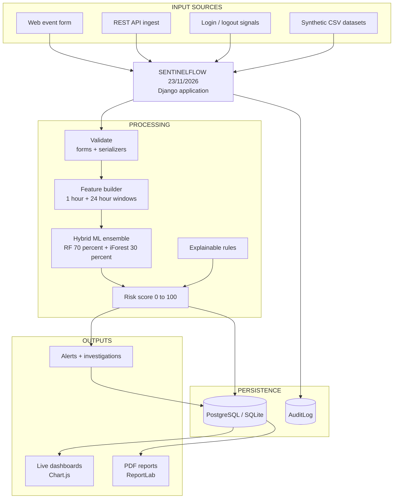
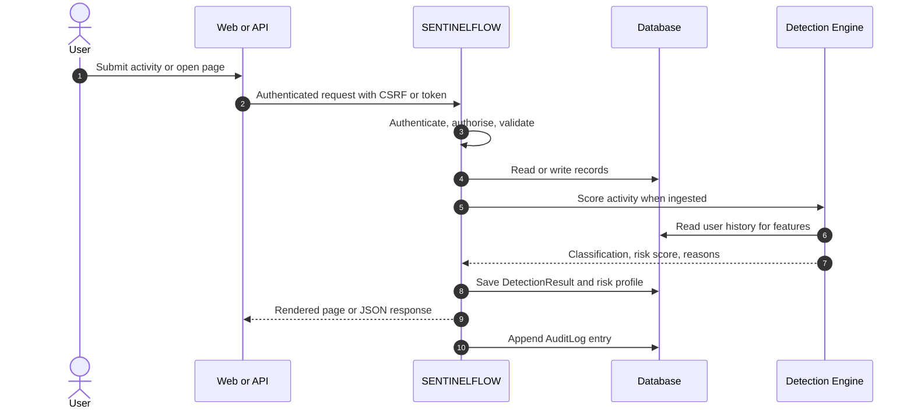
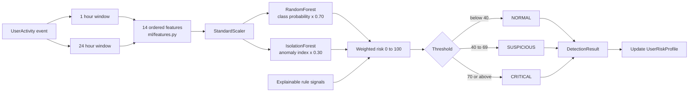
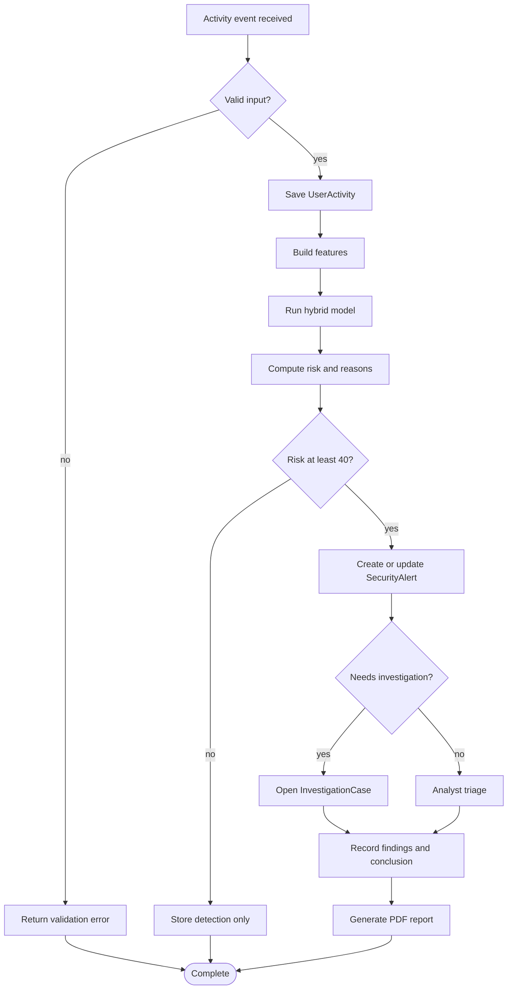
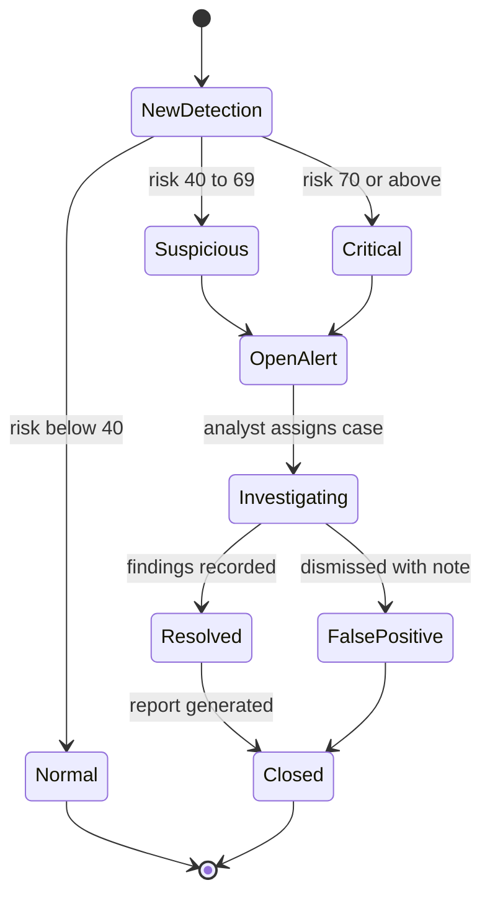
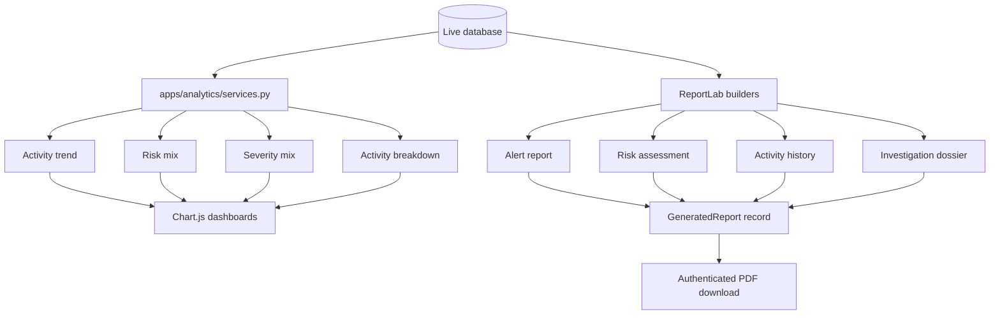
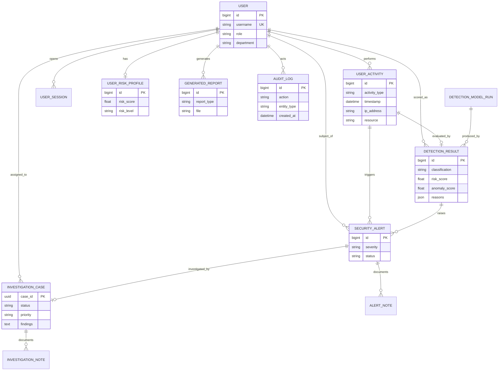
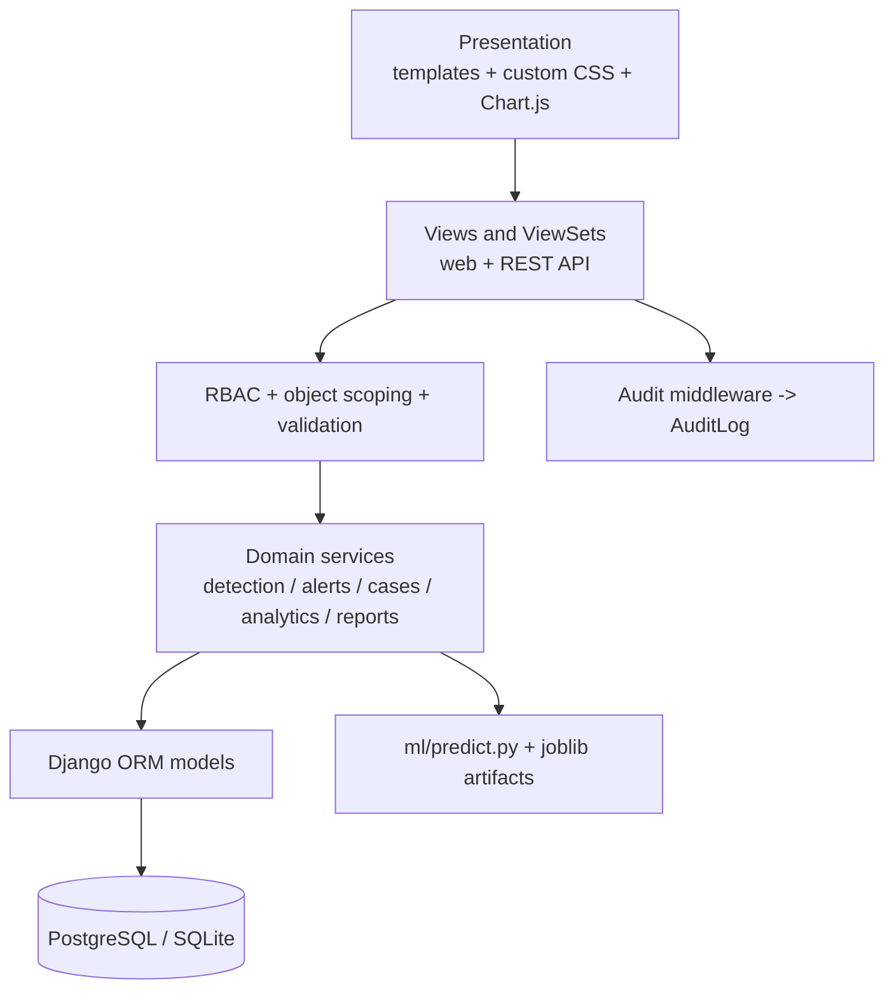

<div align="center">

# SENTINELFLOW

### AI-Powered Insider Threat Detection System

**Release snapshot · 23/11/2026 · Version 1.1.0**

[](SENTINELFLOW/LICENSE)
[](SENTINELFLOW/requirements.txt)
[](SENTINELFLOW/README.md)
[](SENTINELFLOW/README.md#10-verification)

</div>

> **Ethics notice:** SENTINELFLOW ships with deterministic **synthetic** datasets only. It does not collect telemetry from real employees and must never be deployed for covert monitoring. Use only with explicit authorisation, legal review, and transparent notice.

---

## Contents

1. [Overview](#1-overview)
2. [Feature set](#2-feature-set)
3. [Visual documentation](#3-visual-documentation)
   - [3.1 System architecture](#31-system-architecture)
   - [3.2 Request lifecycle](#32-request-lifecycle)
   - [3.3 Detection pipeline](#33-detection-pipeline)
   - [3.4 Operational workflow](#34-operational-workflow)
   - [3.5 Alert and investigation lifecycle](#35-alert-and-investigation-lifecycle)
   - [3.6 Reporting and analytics](#36-reporting-and-analytics)
   - [3.7 Database ER diagram](#37-database-er-diagram)
   - [3.8 Layer and module map](#38-layer-and-module-map)
4. [Project structure](#4-project-structure)
5. [Requirements](#5-requirements)
6. [Installation](#6-installation)
7. [First login and demo accounts](#7-first-login-and-demo-accounts)
8. [Command reference](#8-command-reference)
9. [API quick start](#9-api-quick-start)
10. [Verification](#10-verification)
11. [Deployment overview](#11-deployment-overview)
12. [Troubleshooting](#12-troubleshooting)
13. [Documentation index](#13-documentation-index)
14. [MIT License](#14-mit-license)

---

## 1. Overview

SENTINELFLOW is a complete Django application that monitors synthetic user activity, scores behaviour with a hybrid machine-learning ensemble, raises deduplicated security alerts, supports incident investigations, and generates PDF evidence reports. Every dashboard number is computed from live database records — there are no hardcoded statistics or static UI prototypes.

| Area | What it delivers |
| --- | --- |
| Secure access | PBKDF2 hashing, CSRF, sessions, RBAC (`ADMIN`, `ANALYST`, `VIEWER`), audit logging |
| Ingestion | Web form, REST API, login/logout signals, Django admin, CSV seed command |
| Detection | 1-hour and 24-hour features + Random Forest + Isolation Forest + explainable rules |
| Response | Risk profiles, deduplicated alerts, assignment, notes, investigation cases |
| Evidence | Chart.js dashboards and ReportLab PDF reports |
| Operations | PostgreSQL-ready, SQLite fallback, Gunicorn/WhiteNoise, `.env`-driven hardening |

The application folder is [`SENTINELFLOW/`](SENTINELFLOW/README.md). This root README is the full project guide.

---

## 2. Feature set

- Secure authentication with password validators, CSRF protection, session controls, and full audit logging.
- Role-based access control with read-only `VIEWER` access across both web views and API.
- Activity ingestion through five channels with server-side validation.
- Behavioural feature engineering over 1-hour and 24-hour windows.
- Hybrid detection with a deterministic rule-based fallback when model artifacts are absent.
- Composite 0–100 risk score with `NORMAL`, `SUSPICIOUS`, and `CRITICAL` classifications.
- User risk profiles with `LOW`, `MEDIUM`, `HIGH`, and `CRITICAL` levels.
- Deduplicated alerts with severity, status workflow, assignment, and analyst notes.
- Investigation cases with UUID case IDs, evidence activities, findings, conclusions, and notes.
- Live analytics dashboards with Chart.js visualisations.
- Four PDF report types: alert, risk assessment, activity history, and investigation dossier.
- Environment-controlled HTTPS, cookies, HSTS, CSRF origins, and API throttling.
- 41 automated tests covering web, API, RBAC, ML, alerts, investigations, analytics, and PDFs.

---

## 3. Visual documentation

All diagrams are Mermaid and render directly on GitHub.

### 3.1 System architecture



### 3.2 Request lifecycle



### 3.3 Detection pipeline



### 3.4 Operational workflow



### 3.5 Alert and investigation lifecycle



### 3.6 Reporting and analytics



### 3.7 Database ER diagram



Full ERD: [`docs/er_diagram.md`](SENTINELFLOW/docs/er_diagram.md)

### 3.8 Layer and module map



---

## 4. Project structure

```text
SENTINELFLOW/
├── README.md                    # this complete guide
├── LICENSE                      # MIT License - N J Bala Manikantan
├── CHANGELOG.md                 # version history
├── requirements.txt             # pinned dependency ranges
├── manage.py                    # Django CLI entrypoint
├── apps/
│   ├── accounts/                # custom User, roles, auth forms, profile
│   ├── core/                    # AuditLog, middleware, permissions, API router
│   ├── monitoring/              # UserActivity, UserSession, ingestion services
│   ├── detection/               # DetectionResult, risk profiles, model registry
│   ├── alerts/                  # SecurityAlert, AlertNote, deduplication
│   ├── investigation/           # InvestigationCase, evidence, notes, closure
│   ├── analytics/               # live dashboard and API metrics
│   └── reports/                 # PDF builders and GeneratedReport
├── config/                      # settings, urls, wsgi, asgi
├── data/                        # synthetic CSV datasets
├── docs/                        # architecture, workflow, ERD, structure, API, deployment
├── ml/                          # feature contract, trainer, inference engine
├── scripts/                     # smoke_check.py
├── static/                      # custom CSS and JavaScript
├── templates/                   # reusable Django templates
├── logs/.gitkeep                # runtime logs, ignored by git
└── media/reports/.gitkeep       # generated PDFs, ignored by git
```

Detailed breakdown: [`docs/structure.md`](SENTINELFLOW/docs/structure.md)

---

## 5. Requirements

### 5.1 Prerequisites

| Requirement | Minimum | Notes |
| --- | --- | --- |
| Python | 3.12 | 3.12+ recommended; Django 6 compatible |
| pip | 24 | Ships with modern Python |
| Git | 2.40 | To clone the repository |
| RAM | 4 GB | 8 GB recommended for model training |
| Disk | 500 MB | Datasets, venv, generated artifacts |
| Browser | Modern | Chart.js 4 needs a current browser |
| PostgreSQL | 14 | Optional; SQLite works locally |

### 5.2 Python packages

Installed from [`requirements.txt`](SENTINELFLOW/requirements.txt):

| Package | Version range | Purpose |
| --- | --- | --- |
| `Django` | `>=5.2,<7` | Web framework, ORM, auth, admin |
| `djangorestframework` | `>=3.15,<4` | REST API, serialisers, permissions, throttles |
| `psycopg2-binary` | `>=2.9,<3` | PostgreSQL driver |
| `scikit-learn` | `>=1.4,<2` | Random Forest + Isolation Forest |
| `pandas` | `>=2.1,<3` | Dataset and feature handling |
| `numpy` | `>=1.26,<3` | Numerical operations |
| `joblib` | `>=1.3,<2` | Model artifact persistence |
| `reportlab` | `>=4.0,<5` | PDF report generation |
| `gunicorn` | `>=21.2,<24` | Production WSGI server |
| `whitenoise` | `>=6.6,<7` | Static file serving |
| `python-dotenv` | `>=1.0,<2` | Automatic `.env` loading |

### 5.3 Environment variables

Settings load `.env` automatically. Real environment variables override file values.

| Variable | Default | Purpose |
| --- | --- | --- |
| `DJANGO_SECRET_KEY` | insecure local key | Django signing secret; change in production |
| `DJANGO_DEBUG` | `True` | Debug mode; set `False` in production |
| `DJANGO_ALLOWED_HOSTS` | `localhost,127.0.0.1,[::1]` | Comma-separated hosts |
| `DJANGO_CSRF_TRUSTED_ORIGINS` | empty | Comma-separated origins with scheme, e.g. `https://example.com` |
| `DJANGO_SECURE_SSL_REDIRECT` | `not DEBUG` | Redirect HTTP to HTTPS |
| `DJANGO_SECURE_COOKIES` | `not DEBUG` | Secure session and CSRF cookies |
| `DJANGO_TRUST_X_FORWARDED_PROTO` | `False` | Trust TLS proxy header |
| `DJANGO_HSTS_SECONDS` | `31536000` when not debug | HSTS max age |
| `DJANGO_HSTS_INCLUDE_SUBDOMAINS` | `not DEBUG` | HSTS subdomains |
| `DJANGO_HSTS_PRELOAD` | `not DEBUG` | HSTS preload |
| `DB_ENGINE` | empty | Empty uses SQLite; set PostgreSQL backend for production |
| `DB_NAME` | `sentinelflow` | Database name |
| `DB_USER` | `sentinelflow` | Database user |
| `DB_PASSWORD` | empty | Database password |
| `DB_HOST` | `127.0.0.1` | Database host |
| `DB_PORT` | `5432` | Database port |
| `DB_SSLMODE` | `prefer` | PostgreSQL SSL mode |
| `ML_ARTIFACT_DIR` | `ml/artifacts` | Trained model location |

---

## 6. Installation

### 6.1 Clone and enter the application folder

```bash
git clone https://github.com/Njbalamani/SENTINELFLOW.git
cd SENTINELFLOW
cd SENTINELFLOW
```

> The second `cd` enters the application folder. If you are already inside it, skip that line.

### 6.2 Create a virtual environment

Windows PowerShell:

```powershell
python -m venv .venv
.\.venv\Scripts\Activate.ps1
```

macOS / Linux:

```bash
python3 -m venv .venv
source .venv/bin/activate
```

### 6.3 Install dependencies

```bash
python -m pip install --upgrade pip
python -m pip install -r requirements.txt
python -m pip list
```

### 6.4 Configure the environment file

Windows PowerShell:

```powershell
Copy-Item .env.example .env
notepad .env
```

macOS / Linux:

```bash
cp .env.example .env
nano .env
```

For local development the defaults are sufficient. For production set the security and database variables from section 5.3.

### 6.5 Initialise the database

SQLite is used by default:

```bash
python manage.py migrate
python manage.py createsuperuser
```

### 6.6 Generate synthetic data and train the models

```bash
python -m ml.generate_dataset
python -m ml.train
python manage.py seed_synthetic_data --activities 600
```

Results:

- `data/training_dataset.csv` — 3,600 labelled feature rows.
- `data/sample_user_activity.csv` — 1,500 sample events.
- `ml/artifacts/` — trained Random Forest, Isolation Forest, scaler, and metadata.
- Database — 600 activities, 3 investigation cases, 3 demo users, 48 synthetic subjects.

### 6.7 Collect static files

```bash
python manage.py collectstatic --noinput
```

### 6.8 Run the development server

```bash
python manage.py runserver 0.0.0.0:8000
```

Open <http://127.0.0.1:8000/>.

### 6.9 Optional PostgreSQL setup

SQL:

```sql
CREATE USER sentinelflow WITH PASSWORD 'change-me';
CREATE DATABASE sentinelflow OWNER sentinelflow;
GRANT ALL PRIVILEGES ON DATABASE sentinelflow TO sentinelflow;
```

`.env`:

```dotenv
DB_ENGINE=django.db.backends.postgresql
DB_NAME=sentinelflow
DB_USER=sentinelflow
DB_PASSWORD=change-me
DB_HOST=127.0.0.1
DB_PORT=5432
DB_SSLMODE=require
```

Then rerun `python manage.py migrate` and the seed commands.

---

## 7. First login and demo accounts

Created by `seed_synthetic_data`:

| Username | Password | Role | Access |
| --- | --- | --- | --- |
| `sentinel_admin` | `Sentinel@2026!` | `ADMIN` | Full access, users, audit trail, ML registry |
| `sentinel_analyst` | `Sentinel@2026!` | `ANALYST` | Alerts, investigations, analytics, reports, API writes |
| `sentinel_viewer` | `Sentinel@2026!` | `VIEWER` | Read-only web and API access |

Change these passwords immediately outside local development:

```bash
python manage.py seed_synthetic_data --activities 1000 --password "YourStrongPassword!"
```

---

## 8. Command reference

| Category | Command | Description |
| --- | --- | --- |
| Setup | `python manage.py check` | Validate Django configuration |
| Setup | `python manage.py migrate` | Apply database migrations |
| Setup | `python manage.py makemigrations` | Create migrations after model changes |
| Setup | `python manage.py createsuperuser` | Create a real administrator |
| Setup | `python manage.py collectstatic` | Collect static files into `staticfiles/` |
| Data | `python -m ml.generate_dataset` | Regenerate synthetic CSV datasets |
| Data | `python -m ml.train` | Train RF + iForest and write artifacts |
| Data | `python manage.py seed_synthetic_data --activities 600` | Seed users, activities, alerts, cases |
| Data | `python manage.py train_models --regenerate` | Regenerate data and retrain in one command |
| Data | `python manage.py sync_model_metadata` | Register active artifact metadata in database |
| Run | `python manage.py runserver` | Development server |
| Run | `gunicorn config.wsgi:application --bind 0.0.0.0:8000 --workers 3` | Production server |
| Test | `python manage.py test` | Run all 41 tests |
| Test | `python scripts/smoke_check.py` | GET every major web and API route |
| Test | `python manage.py check --deploy` | Production settings audit |
| Debug | `python manage.py shell` | Django interactive shell |
| Debug | `python manage.py dbshell` | Database shell |
| Debug | `python manage.py showmigrations` | List migration status |

---

## 9. API quick start

Obtain a token:

```bash
curl -X POST http://127.0.0.1:8000/api/v1/auth/token/ \
  -H "Content-Type: application/json" \
  -d "{\"username\":\"sentinel_admin\",\"password\":\"Sentinel@2026!\"}"
```

Use the token:

```bash
curl http://127.0.0.1:8000/api/v1/activities/ \
  -H "Authorization: Token YOUR_TOKEN_HERE"
```

Ingest an activity:

```bash
curl -X POST http://127.0.0.1:8000/api/v1/activities/ \
  -H "Authorization: Token YOUR_TOKEN_HERE" \
  -H "Content-Type: application/json" \
  -d "{\"user\":1,\"activity_type\":\"LOGIN\",\"timestamp\":\"2026-11-23T10:00:00Z\",\"ip_address\":\"192.0.2.10\",\"resource\":\"web-app\",\"bytes_transferred\":1024}"
```

Full endpoint reference: [`docs/api.md`](SENTINELFLOW/docs/api.md)

---

## 10. Verification

```bash
python manage.py check
python manage.py test
python scripts/smoke_check.py
python manage.py check --deploy
```

| Check | Result |
| --- | --- |
| `python manage.py check` | No issues |
| `python manage.py test` | 41 tests OK, 1 skipped until models are trained |
| `python scripts/smoke_check.py` | All routes return `200` after seeding |
| Snapshot date | **23/11/2026** |

---

## 11. Deployment overview

Production environment variables:

```dotenv
DJANGO_DEBUG=False
DJANGO_ALLOWED_HOSTS=your-domain.example,www.your-domain.example
DJANGO_CSRF_TRUSTED_ORIGINS=https://your-domain.example,https://www.your-domain.example
DJANGO_SECURE_SSL_REDIRECT=True
DJANGO_SECURE_COOKIES=True
DJANGO_TRUST_X_FORWARDED_PROTO=True
DJANGO_HSTS_SECONDS=31536000
DJANGO_HSTS_INCLUDE_SUBDOMAINS=True
DJANGO_HSTS_PRELOAD=True
```

Serve with Gunicorn behind a TLS-terminating proxy:

```bash
gunicorn config.wsgi:application --bind 0.0.0.0:8000 --workers 3 --timeout 120
```

Full guide: [`docs/deployment.md`](SENTINELFLOW/docs/deployment.md)

---

## 12. Troubleshooting

| Symptom | Cause | Fix |
| --- | --- | --- |
| `ModuleNotFoundError: No module named 'django'` | Virtual environment not active | Activate `.venv` then `pip install -r requirements.txt` |
| `DisallowedHost` | Host not allowed | Add host to `DJANGO_ALLOWED_HOSTS` |
| `CSRF verification failed` | Origin not trusted | Add `https://your-domain` to `DJANGO_CSRF_TRUSTED_ORIGINS` |
| `ML artifacts not found` | Models not trained | Run `python -m ml.train` |
| Static files return 404 | Static files not collected | Run `python manage.py collectstatic --noinput` |
| Port 8000 already in use | Another process | Run `python manage.py runserver 8001` |
| Tests report 1 skip | Joblib artifacts absent in fresh clone | Run `python -m ml.train` to enable the ML-specific test |

---

## 13. Documentation index

| Document | Description |
| --- | --- |
| [Architecture](SENTINELFLOW/docs/architecture.md) | Layered design and request flow |
| [Workflow](SENTINELFLOW/docs/workflow.md) | Ingestion to report workflow diagrams |
| [ER diagram](SENTINELFLOW/docs/er_diagram.md) | Complete database relationships |
| [Structure](SENTINELFLOW/docs/structure.md) | Module responsibility matrix |
| [API reference](SENTINELFLOW/docs/api.md) | Endpoints, filters, payloads, examples |
| [Deployment](SENTINELFLOW/docs/deployment.md) | Production environment and operations |
| [Changelog](SENTINELFLOW/CHANGELOG.md) | Version history |
| [Application README](SENTINELFLOW/README.md) | Same guide inside the application folder |

---

## 14. MIT License

MIT — full text also in [`SENTINELFLOW/LICENSE`](SENTINELFLOW/LICENSE).

```text
MIT License

Copyright (c) 2026 N J Bala Manikantan

Permission is hereby granted, free of charge, to any person obtaining a copy
of this software and associated documentation files (the "Software"), to deal
in the Software without restriction, including without limitation the rights
to use, copy, modify, merge, publish, distribute, sublicense, and/or sell
copies of the Software, and to permit persons to whom the Software is
furnished to do so, subject to the following conditions:

The above copyright notice and this permission notice shall be included in all
copies or substantial portions of the Software.

THE SOFTWARE IS PROVIDED "AS IS", WITHOUT WARRANTY OF ANY KIND, EXPRESS OR
IMPLIED, INCLUDING BUT NOT LIMITED TO THE WARRANTIES OF MERCHANTABILITY,
FITNESS FOR A PARTICULAR PURPOSE AND NONINFRINGEMENT. IN NO EVENT SHALL THE
AUTHORS OR COPYRIGHT HOLDERS BE LIABLE FOR ANY CLAIM, DAMAGES OR OTHER
LIABILITY, WHETHER IN AN ACTION OF CONTRACT, TORT OR OTHERWISE, ARISING FROM,
OUT OF OR IN CONNECTION WITH THE SOFTWARE OR THE USE OR OTHER DEALINGS IN THE
SOFTWARE.
```

<div align="center">

**SENTINELFLOW · 23/11/2026 · Copyright (c) 2026 N J Bala Manikantan · MIT License**

</div>
