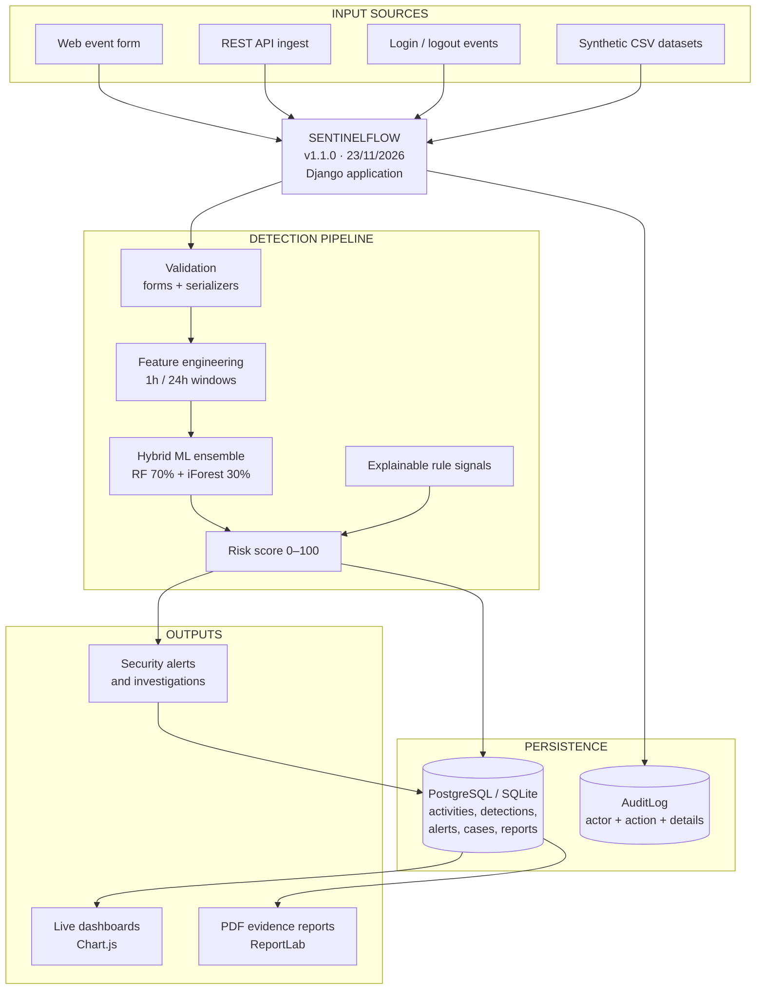
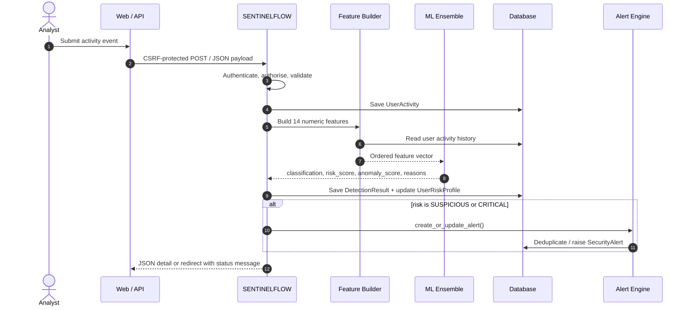
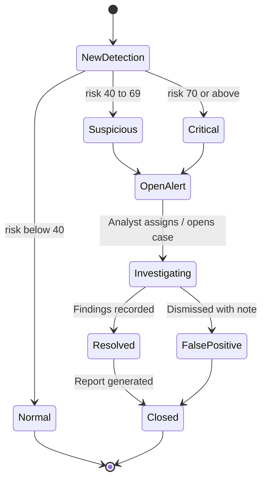
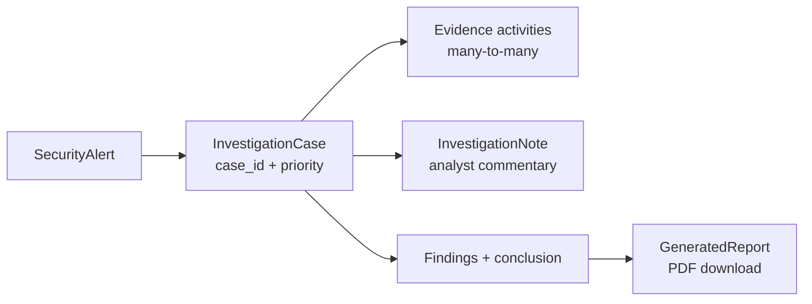
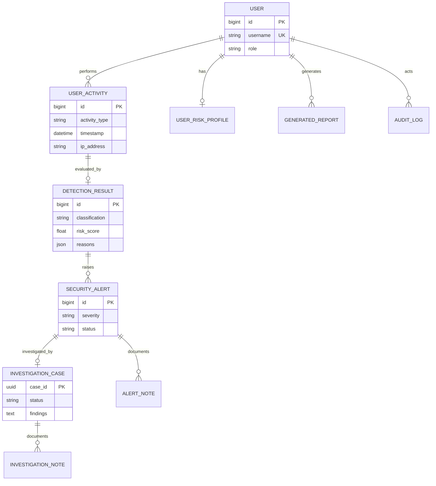

<div align="center">

# SENTINELFLOW

### AI-Powered Insider Threat Detection System

**Release date: 23/11/2026** · **Version 1.1.0**


</div>

> **Ethics notice:** SENTINELFLOW ships with deterministic **synthetic** datasets only. It does not collect telemetry from real employees and must never be deployed for covert monitoring. Use only with explicit authorisation, legal review, and transparent notice.

---

## Table of contents

- [Why SENTINELFLOW](#why-sentinelflow)
- [System architecture](#system-architecture)
- [Detection workflow](#detection-workflow)
- [Alert and investigation lifecycle](#alert-and-investigation-lifecycle)
- [Entity relationship overview](#entity-relationship-overview)
- [Project structure](#project-structure)
- [Technology stack](#technology-stack)
- [Quick start](#quick-start)
- [Demo accounts](#demo-accounts)
- [Testing and verification](#testing-and-verification)
- [Security controls](#security-controls)
- [Documentation](#documentation)
- [License](#license)

---

## Why SENTINELFLOW

SENTINELFLOW is a full-stack Django application that monitors synthetic user activity, scores behaviour with a hybrid machine-learning ensemble, raises deduplicated security alerts, supports incident investigations, and generates PDF evidence reports. Every dashboard number is computed from live database records — there are no hardcoded statistics or static UI prototypes.

| Capability | What it delivers |
| --- | --- |
| Secure access | PBKDF2 password hashing, CSRF, session controls, RBAC (`ADMIN`, `ANALYST`, `VIEWER`), audit logging |
| Ingestion | Web UI, REST API, Django admin, CSV seed command, SIEM-style batch import |
| Detection | 1h/24h behavioural features + `RandomForestClassifier` + `IsolationForest` + explainable rule fallback |
| Response | Risk profiles, deduplicated alerts, assignment, notes, investigation cases, closure workflow |
| Evidence | Chart.js analytics dashboards and ReportLab PDF reports |
| Operations | PostgreSQL-ready settings, SQLite fallback, Gunicorn/WhiteNoise, `.env`-driven hardening |

---

## System architecture



---

## Detection workflow



**Scoring model**

- Random Forest class probabilities contribute **70%** of the risk score.
- Isolation Forest anomaly index contributes **30%**.
- Rule signals (off-hours, unusual location, large transfer, privileged resource, failed logins, burst activity) are attached as human-readable reasons.
- If model artifacts are unavailable, the system degrades to the deterministic rule engine rather than failing.

---

## Alert and investigation lifecycle





---

## Entity relationship overview



Full ERD: [docs/er_diagram.md](docs/er_diagram.md)

---

## Project structure

```text
SENTINELFLOW/                         # repository folder · 23/11/2026
├── apps/
│   ├── accounts/                     # Custom user model, roles, auth forms, profile
│   ├── core/                         # AuditLog, middleware, permissions, API router
│   ├── monitoring/                   # UserActivity, UserSession, ingestion services
│   ├── detection/                    # Detections, risk profiles, model registry, ML services
│   ├── alerts/                       # Alert lifecycle, deduplication, notes
│   ├── investigation/                # Cases, evidence, notes, closure workflow
│   ├── analytics/                    # Live dashboard and API metric services
│   └── reports/                      # ReportLab PDF builders and download views
├── config/                           # settings, urls, wsgi, asgi
├── data/                             # synthetic CSV datasets
├── docs/
│   ├── architecture.md               # Layered architecture diagram
│   ├── er_diagram.md                 # Full Mermaid ER diagram
│   ├── workflow.md                   # End-to-end workflow diagrams
│   ├── structure.md                  # Module responsibility matrix
│   ├── api.md                        # REST API reference
│   └── deployment.md                 # Production deployment guide
├── ml/
│   ├── features.py                   # Single source of truth for feature order
│   ├── generate_dataset.py           # Synthetic dataset generator
│   ├── train.py                      # RF + iForest trainer
│   ├── predict.py                    # Hybrid inference + rule fallback
│   └── artifacts/.gitkeep            # Generated models written here at runtime
├── scripts/
│   └── smoke_check.py                # End-to-end route verification
├── static/                           # Custom CSS and JavaScript
├── templates/                        # Reusable Django templates and components
├── logs/.gitkeep                     # Runtime logs (ignored)
├── media/reports/.gitkeep            # Generated PDFs (ignored)
├── CHANGELOG.md
├── LICENSE                           # MIT License
├── README.md
├── manage.py
└── requirements.txt
```

Detailed breakdown: [docs/structure.md](docs/structure.md)

---

## Technology stack

| Layer | Technology |
| --- | --- |
| Frontend | HTML5, CSS3 (custom SOC theme), vanilla JavaScript, Chart.js 4 |
| Backend | Python 3.12+, Django 6, Django REST Framework |
| Machine learning | scikit-learn (Random Forest, Isolation Forest), pandas, NumPy, joblib |
| Database | PostgreSQL (production) / SQLite (local development) |
| Reporting | ReportLab |
| Serving | Gunicorn + WhiteNoise |
| Configuration | `python-dotenv`, environment-driven security flags |
| Testing | Django `TestCase`, DRF API tests, ML unit tests |

---

## Quick start

```powershell
cd SENTINELFLOW
python -m venv .venv
.\.venv\Scripts\Activate.ps1
pip install -r requirements.txt

cp .env.example .env        # Windows: Copy-Item .env.example .env
python manage.py migrate
python -m ml.generate_dataset
python -m ml.train
python manage.py seed_synthetic_data --activities 600
python manage.py runserver
```

Open <http://127.0.0.1:8000/>.

> Model artifacts and the SQLite database are intentionally **not committed**. Generate them with the commands above after cloning.

---

## Demo accounts

Created by `seed_synthetic_data` (default password: `Sentinel@2026!` — change it immediately for any non-local use):

| Username | Role | Access |
| --- | --- | --- |
| `sentinel_admin` | `ADMIN` | Full access, user management, audit trail, ML registry |
| `sentinel_analyst` | `ANALYST` | Alerts, investigations, analytics, reports, API writes |
| `sentinel_viewer` | `VIEWER` | Read-only dashboard, activity, alerts, reports |

48 additional `userNNN` accounts represent synthetic monitored subjects.

---

## Testing and verification

```powershell
python manage.py check
python manage.py test
python scripts/smoke_check.py     # requires a seeded database
python manage.py check --deploy   # production settings audit
```

Latest verified run: **41 tests OK** (1 skipped until model artifacts are trained) · system check clean · all smoke routes `200` after seeding.

---

## Security controls

- Django PBKDF2 password hashing plus `UserAttributeSimilarity`, `MinimumLength`, `CommonPassword` and `NumericPassword` validators.
- CSRF on every state-changing web/API request; session and token authentication supported.
- Role checks in both web views and DRF permissions, with per-queryset scoping of subjects.
- Input validation in forms and serializers (byte counts, dates, status enums, resource lengths).
- Sensitive POST fields are redacted from audit records; passwords are never logged.
- Environment-controlled HTTPS redirect, secure cookies, HSTS, SameSite, referrer policy, `X-Frame-Options: DENY`, trusted CSRF origins, and throttles (`anon: 20/hour`, `user: 1000/hour`).
- Generic 403/404/500 pages; stack traces are logged server-side only.
- Structured `sentinelflow` logger writing to `logs/sentinelflow.log`.

---

## Documentation

| Document | Description |
| --- | --- |
| [Architecture](docs/architecture.md) | Layered system diagram and request flow |
| [ER diagram](docs/er_diagram.md) | Complete database relationships and indexes |
| [Workflow](docs/workflow.md) | Ingestion, detection, alerting, investigation and reporting flows |
| [Structure](docs/structure.md) | Module responsibility matrix and coding conventions |
| [API reference](docs/api.md) | Endpoints, auth, filters, payloads and examples |
| [Deployment](docs/deployment.md) | Production environment, TLS, Gunicorn and backups |
| [Changelog](CHANGELOG.md) | Version history |

---

## License

MIT — see [LICENSE](LICENSE).

<div align="center">

**SENTINELFLOW · 23/11/2026 · Built for authorised, transparent, synthetic-data security engineering.**

</div>
