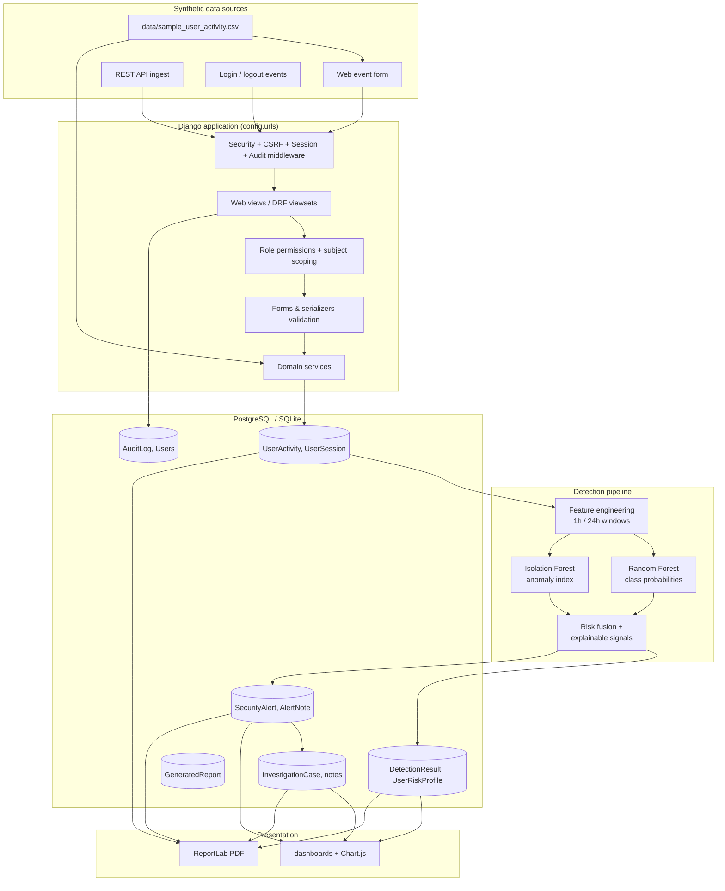

# System architecture

## Request flow

1. **Ingestion** — events arrive from login/logout tracking, the web form, REST API, or the synthetic CSV seeder.
2. **Validation** — Django forms and DRF serializers validate types, lengths and ranges before persistence.
3. **Persistence** — `UserActivity` stores immutable event facts with timestamp, IP, resource, byte count and source.
4. **Feature engineering** — `apps/detection/features.py` derives 14 numeric features from the event plus prior user history. Feature names are shared with the ML package via `ml/features.py`.
5. **Inference** — `ml/predict.py` loads cached joblib artifacts, blends Random Forest class probabilities (70%) with the Isolation Forest anomaly index (30%), and attaches explainable rule signals. If artifacts are missing it degrades to the deterministic rule engine instead of failing.
6. **Risk update** — `UserRiskProfile` is recomputed from 30 days of detections using a weighted average/max blend.
7. **Alerting** — suspicious/critical detections create deduplicated alerts with evidence snapshots; analysts triage them and open investigation cases.
8. **Presentation** — all dashboard metrics come from `apps/analytics/services.py` database queries; PDFs are generated on demand from the same records.

## Machine learning contract

`ml/features.py::FEATURE_NAMES` is the single source of truth for feature order. `ml/generate_dataset.py` writes 3,600 labelled feature rows and 1,500 event rows with seed 42. `ml/train.py` performs a stratified 80/20 split, scales features with `StandardScaler`, trains both models, evaluates accuracy/weighted F1, and stores artifacts in `ml/artifacts/`. The latest run is registered in `DetectionModelRun`.

## Security boundaries

- Authentication and role checks run at both the web-view and API-permission layers.
- Viewer querysets are scoped to their own subject records.
- Every state-changing request is audited; sensitive fields are redacted.
- CSRF is enforced on session-authenticated writes; token authentication remains available for integrations.
- Application errors are logged server-side and rendered as generic 403/404/500 pages.
