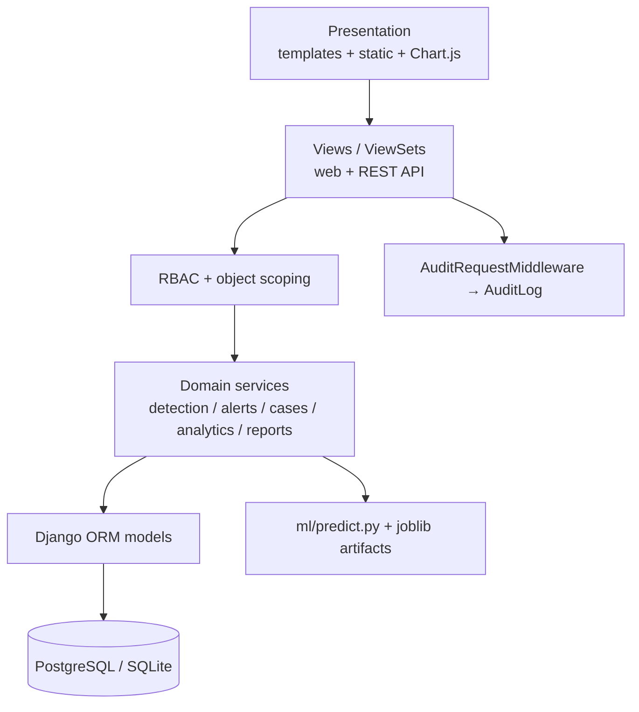

# Project structure and responsibilities

> SENTINELFLOW · **23/11/2026**

## Top-level layout

```text
SENTINELFLOW/
├── apps/                     # Django applications (one responsibility per app)
│   ├── accounts/
│   ├── core/
│   ├── monitoring/
│   ├── detection/
│   ├── alerts/
│   ├── investigation/
│   ├── analytics/
│   └── reports/
├── config/                   # Project-level settings and entrypoints
│   ├── settings.py
│   ├── urls.py
│   ├── wsgi.py
│   └── asgi.py
├── data/                     # Synthetic CSV datasets (committed)
├── docs/                     # Professional documentation and diagrams
├── ml/                       # Feature contract, trainer, inference engine
├── scripts/                  # Developer verification utilities
├── static/                   # Custom CSS + JavaScript
├── templates/                # Base shell, components and app pages
├── logs/.gitkeep
├── media/reports/.gitkeep
├── ml/artifacts/.gitkeep
├── CHANGELOG.md
├── LICENSE
├── README.md
├── manage.py
└── requirements.txt
```

---

## Module responsibility matrix

| Module | Models | Main views / APIs | Services | Purpose |
| --- | --- | --- | --- | --- |
| `apps.accounts` | `User` | Login, register, profile, user management | Forms / validators | Custom user with `ADMIN`, `ANALYST`, `VIEWER` roles |
| `apps.core` | `AuditLog` | `/audit/`, `/health/`, error handlers | Audit middleware, permissions, shared API router | Cross-cutting concerns and API aggregation |
| `apps.monitoring` | `UserActivity`, `UserSession` | Activity list/detail/create, `activities` API | Ingestion, session tracking | Raw event capture and session lifecycle |
| `apps.detection` | `DetectionResult`, `UserRiskProfile`, `DetectionModelRun` | Detections, risk profiles, model registry, APIs | Feature builder, risk services, model commands | ML scoring, explainability and model registry |
| `apps.alerts` | `SecurityAlert`, `AlertNote` | Alert list/detail, status actions, APIs | Deduplication and severity mapping | Triage queue for suspicious behaviour |
| `apps.investigation` | `InvestigationCase`, `InvestigationNote` | Case list/detail/create, APIs | `create_case_from_alert()` | Formal incident handling and evidence linkage |
| `apps.analytics` | — | Dashboard, analytics, `analytics/summary` API | Live aggregation helpers | Chart-ready metrics with zero hardcoded values |
| `apps.reports` | `GeneratedReport` | Report list/generate/download | ReportLab builders | PDF evidence exports |
| `ml` | — | Management commands | `features.py`, `generate_dataset.py`, `train.py`, `predict.py` | Dataset generation, training and hybrid inference |
| `config` | — | Root URLConf | Settings, WSGI/ASGI | Environment config, security flags, logging |

---

## Layer diagram



---

## Coding conventions

- One Django app per business domain; shared logic lives in `apps.core`.
- Business rules belong in `services.py`, not in views.
- `ml/features.py::FEATURE_NAMES` is the single source of truth for feature order — never duplicate it.
- All list endpoints use server-side filtering/pagination via DRF.
- Every state-changing request should leave an `AuditLog` entry.
- Templates extend `base.html`; reusable fragments live in `templates/components/`.
- Thresholds and tunable values live in `config.settings.SENTINELFLOW`.
- Never commit `.env`, `db.sqlite3`, `staticfiles/`, runtime logs, generated PDFs, or trained joblib files.

---

## Git-ignored runtime paths

| Path | Reason | Recreate with |
| --- | --- | --- |
| `.env` | Contains secrets | `Copy-Item .env.example .env` |
| `db.sqlite3` | Local database | `python manage.py migrate` + seed command |
| `staticfiles/` | Collectstatic output | `python manage.py collectstatic` |
| `logs/*.log` | Runtime logs | Automatic on first request |
| `media/reports/*.pdf` | Generated evidence | Report generation view |
| `ml/artifacts/*.joblib` | Trained models | `python -m ml.train` |

---

## Verification checklist

```powershell
python manage.py check
python manage.py test
python scripts/smoke_check.py
python manage.py check --deploy
```

**Verified on 23/11/2026:** `check` clean · **41 tests passing** · smoke routes all `200`.
