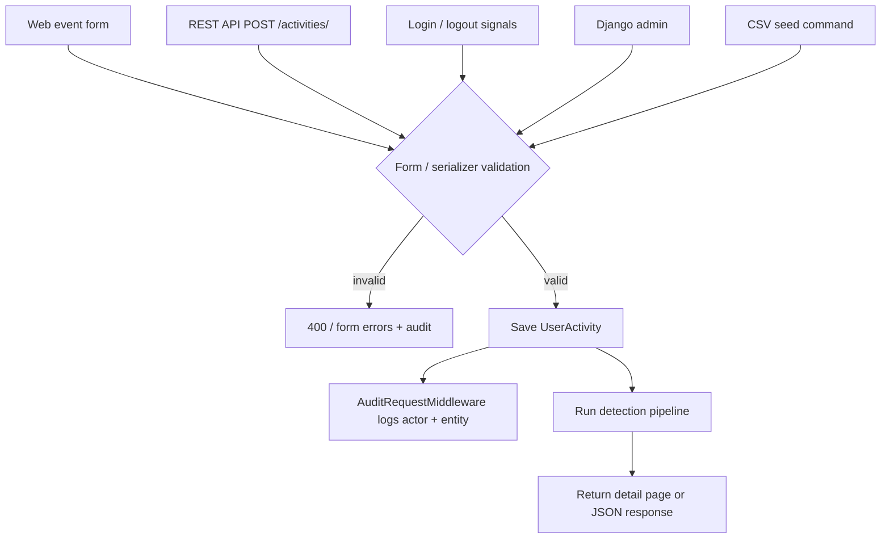
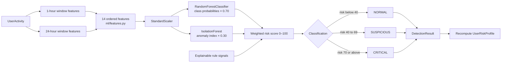
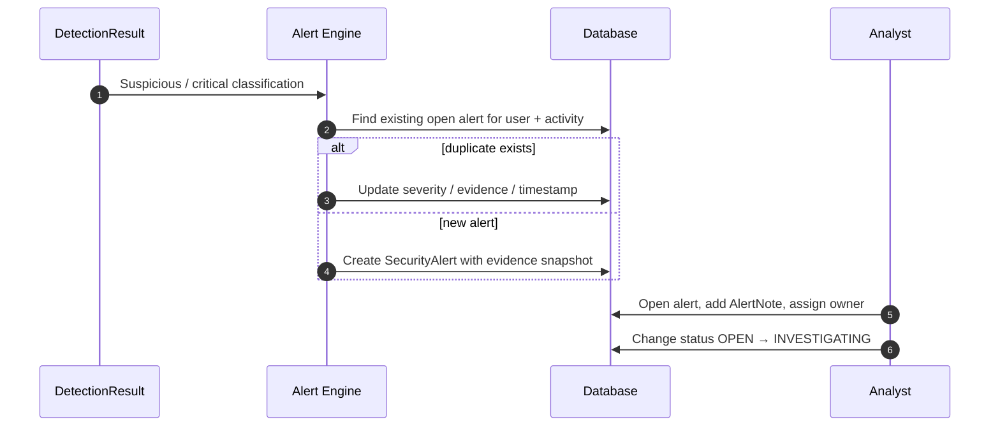
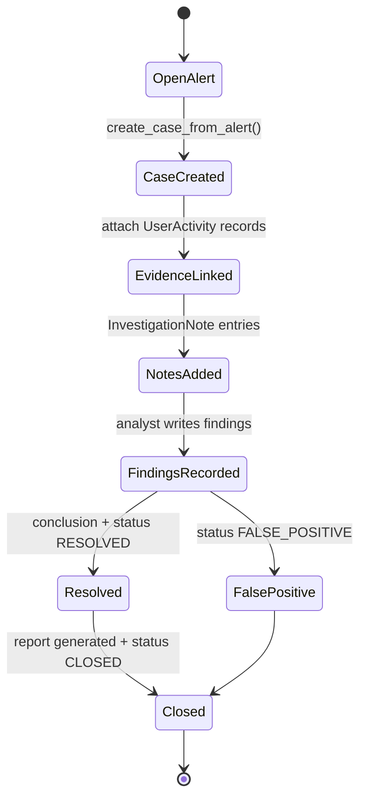
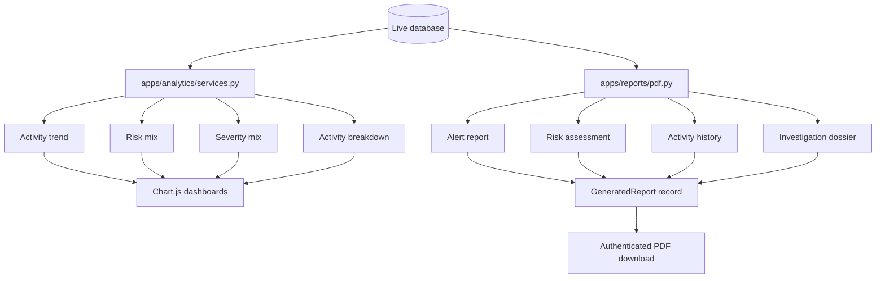

# End-to-end workflows

> SENTINELFLOW · **23/11/2026**

This document describes the five operational flows that power the application. Diagrams use Mermaid and render natively on GitHub.

---

## 1. Activity ingestion

Events can enter from five sources. Every path converges on validation, persistence, and detection.

**Validation rules**

- `activity_type`, `timestamp`, `ip_address`, `resource` are required.
- `bytes_transferred` must be a non-negative integer.
- Viewers cannot write; the API enforces read-only permissions.
- Sensitive POST fields are redacted before audit persistence.

---

## 2. Detection and scoring

**Fallback behaviour**

If `ml/artifacts/*.joblib` is missing, `ml/predict.py` uses deterministic rules only and records `model_name="RULE_BASED_FALLBACK"`. The application never fails because a model file is absent.

---

## 3. Alert creation and triage

Deduplication key: `(user_id, activity_id, status in open states)`. Re-scoring an activity strengthens the existing alert instead of flooding the queue.

---

## 4. Investigation workflow

A case carries a UUID `case_id`, priority, assigned analyst, linked alert, evidence activities, findings, conclusion, and a chronological note stream.

---

## 5. Reporting and analytics

No dashboard value is cached in source code. Every metric is derived from `UserActivity`, `DetectionResult`, `UserRiskProfile`, `SecurityAlert` and `InvestigationCase` at request time.

---

## Operational runbook

| Situation | Action |
| --- | --- |
| First setup | `python manage.py migrate` → `python -m ml.generate_dataset` → `python -m ml.train` → `python manage.py seed_synthetic_data --activities 600` |
| Refresh models | `python manage.py train_models --regenerate` then restart workers |
| Verify routes | `python scripts/smoke_check.py` |
| Verify code | `python manage.py check` and `python manage.py test` |
| Rotate demo password | `python manage.py seed_synthetic_data --activities 1000 --password "NewStrong!"` or change users in admin |
| Production | Follow [deployment.md](deployment.md) |
